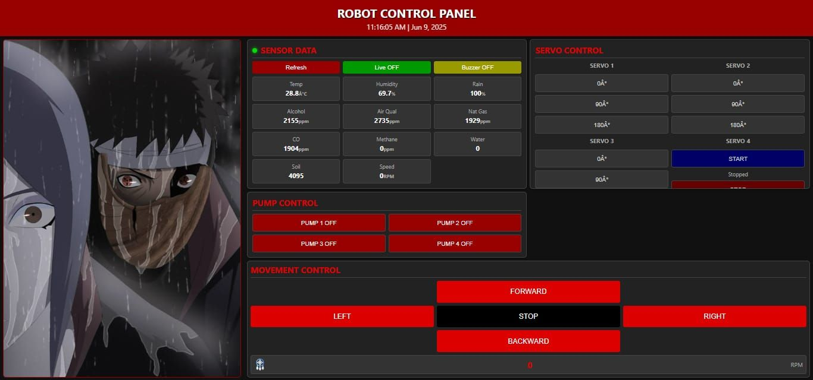
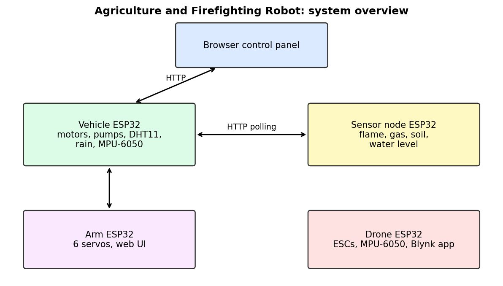
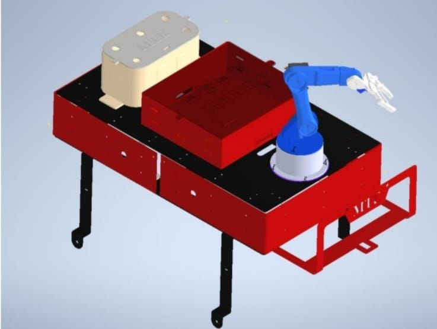
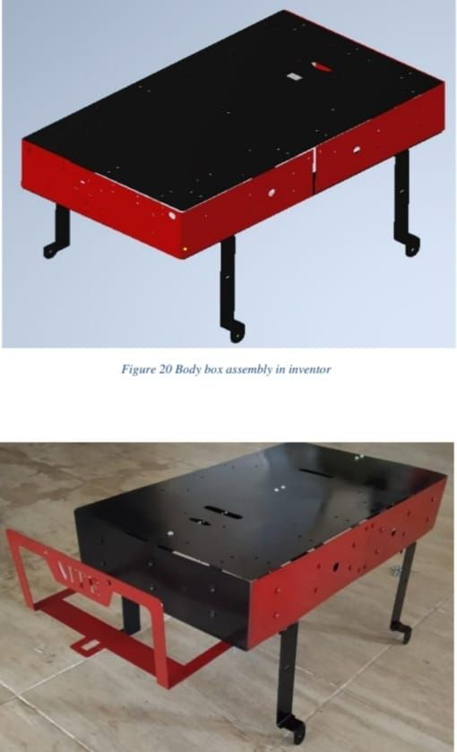
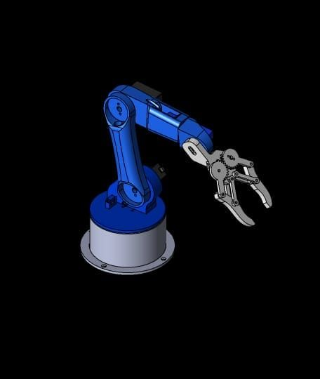
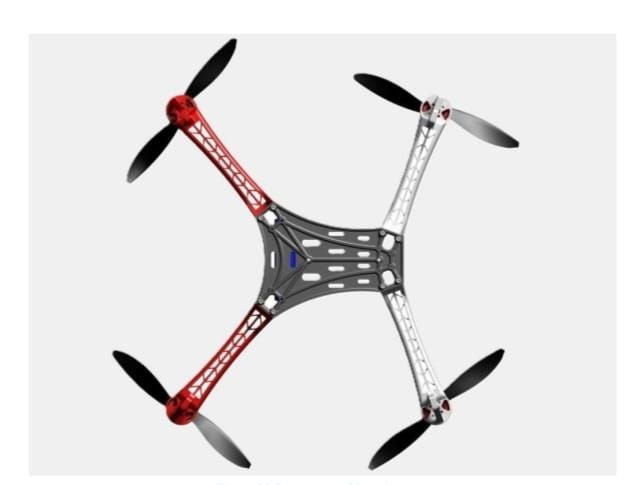
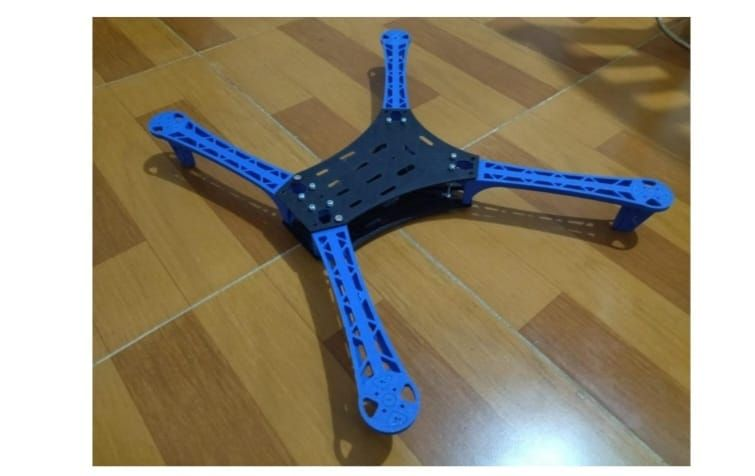
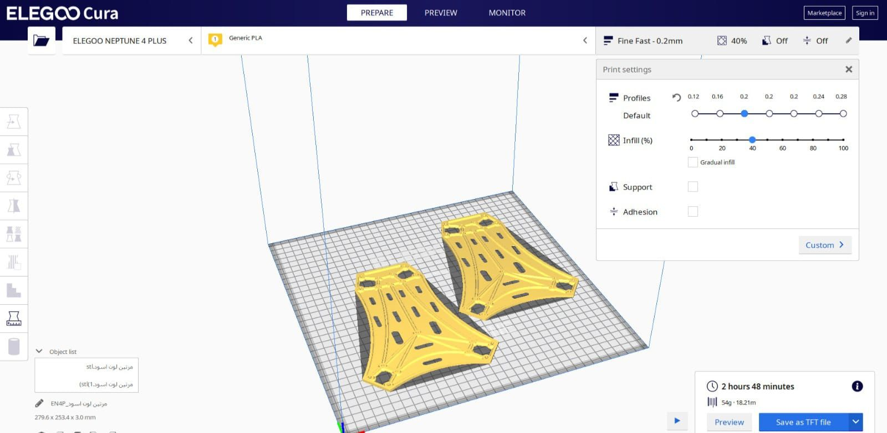
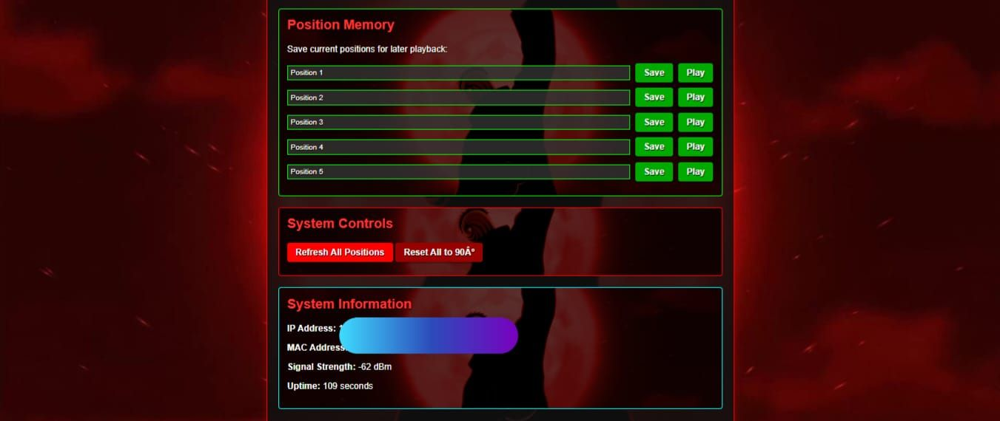

<h1 align="center">Agriculture and Firefighting Robot</h1>

<p align="center">
An end-to-end robotic system that monitors a farm and responds to fires:<br>
ground vehicle, 6-DOF arm, sensor node and scouting drone.
</p>

<p align="center">
  
  
  
  
  
</p>

<p align="center">
  
  <br>
  <sub>Vehicle control panel: live sensor readings, pump switches, servo controls and drive buttons.</sub>
</p>

## Contents

[Overview](#overview) · [What it does](#what-it-does) · [Architecture](#architecture) · [Hardware](#hardware) · [Mechanical design](#mechanical-design) · [Web interface](#web-interface) · [Software](#software) · [Repository layout](#repository-layout) · [Problems and fixes](#problems-we-hit-and-what-fixed-them) · [Limits](#limits) · [Next steps](#possible-next-steps) · [Report](#report) · [Author](#author)

## Overview

Graduation project, B.Sc. Mechatronics and Robotics Engineering, Mansoura University (2025), graded 100/100.

The project covers the whole chain: mechanical design, electronics, firmware and a browser control panel. A ground vehicle carries a robotic arm and water pumps, a separate sensor node watches the field, and a small drone scouts from the air. The goal was one system that can monitor a farm and respond to a fire, from the CAD model to the code running on the boards.

## What it does

| Part | Function |
|---|---|
| **Ground vehicle** | Four DC motors, each with its own L298N driver. Controlled from the web page or by tilting a hand-worn MPU-6050. Reads temperature and humidity (DHT11) and rain locally, and measures wheel RPM with an interrupt-based tachometer. |
| **Sensor node** | A separate ESP32 reads flame, gas, soil moisture and water level and serves the readings to the vehicle over HTTP. The vehicle polls it. |
| **Fire response** | Flame sensors drive relays that switch the water pumps. Pump 1 uses two flame sensors, pump 2 uses one. Flame events are also sent as Telegram messages. |
| **Robotic arm** | Six servos (MG995 and SG90) with angle limits of 0 to 180 degrees enforced in code. The web UI has per-servo control, 5 saved positions (position memory), and recording and playback of up to 100 movements. The arm can also be driven by flex sensors worn on the fingers of a glove, mapped to the arm joints. |
| **Scouting drone** | ESP32 flight controller, brushless motors with ESCs (PWM 1000 to 2000), MPU-6050, 11.1 V 3300 mAh 35C LiPo. Flown from a Blynk virtual joystick with gradual PWM steps. |

## Architecture

<p align="center">
  
  <br>
  <sub>System overview. Everything runs over plain HTTP on one Wi-Fi network.</sub>
</p>

A FreeRTOS task handles sensor polling so it does not block the web server.

## Hardware

| Part | Used for |
|---|---|
| ESP32 (Arduino framework) | Vehicle, sensor node, arm, drone |
| 4 L298N motor drivers (one per motor), DC motors | Vehicle drive |
| MG995 / SG90 servos | Arm, 6 axes |
| Water pumps and relays | Fire response |
| DHT11, rain, soil, water level, flame, gas sensors | Monitoring |
| MPU-6050 | Tilt control, drone stability |
| Brushless motors, ESCs, LiPo 11.1 V 3300 mAh | Drone |

The vehicle is built from medium carbon steel sheet (3 mm and 1 mm), and the drone frame is 3D printed.

## Mechanical design

Everything was modeled in Autodesk Inventor before it was built.

<table>
  <tr>
    <td align="center" width="50%"><br><sub>Vehicle with arm, CAD assembly</sub></td>
    <td align="center" width="50%"><br><sub>Body box in Inventor (top) and the built chassis (bottom)</sub></td>
  </tr>
  <tr>
    <td align="center"><br><sub>6-DOF robotic arm</sub></td>
    <td align="center"><br><sub>Drone frame, CAD top view</sub></td>
  </tr>
  <tr>
    <td align="center"><br><sub>3D printed drone frame</sub></td>
    <td align="center"><br><sub>Center plates sliced in Cura (Elegoo Neptune 4 Plus, PLA, 0.2 mm, 40% infill, about 2 h 48 min)</sub></td>
  </tr>
</table>

## Web interface

The control pages are served from the ESP32. The arm page uses the same design: five named position slots with Save and Play, plus refresh, reset to 90 degrees and a system info panel (IP and MAC blurred).

<p align="center">
  
  <br>
  <sub>Arm web interface: position memory and system controls.</sub>
</p>

## Software

C and C++ on the ESP32 with these libraries: WiFi, WebServer, HTTPClient, ArduinoJson, ESPmDNS, ESP32Servo, DHT, MPU6050. Fire alerts go out through the Telegram Bot API. The control pages are HTML, CSS and JavaScript served straight from the ESP32. The drone uses Blynk.

## Repository layout

```
images/                screenshots, CAD renders, photos
firmware/vehicle/      vehicle controller
firmware/sensor_node/  flame, gas, soil, water level node
firmware/arm/          arm controller and web UI
docs/                  project report (PDF)
```

Wi-Fi name and password are placeholders in `config.example.h`. Copy it to `config.h` and fill in your own network. Do not commit `config.h`.

## Problems we hit and what fixed them

- **A burned ESP32.** Most of the sensors were on one ESP32 and the board burned out from the current load. The fix was to spread the sensors across several ESP32 boards.
- **A burned motor driver.** All four motors were connected to one motor driver, and it burned out. The fix was one driver per motor, four in total.
- **Slow arm response.** The arm responded late to commands. We tuned the arm control to fix it.
- **Weak drone battery.** The battery's C rating was too low for the takeoff current. We replaced it with a higher-rated one.

## Limits

- Plain HTTP on a shared Wi-Fi network, no authentication. Fine for a prototype, not for field use.
- The sensor node address is hard-coded in the vehicle code.
- The robot depends on Wi-Fi. If the connection drops, it stops, and in an area with no network it will not run. Control is manual or tilt-based, with no autonomous navigation.
- The drone needs a high-capacity, high-C-rating battery.
- The vehicle motors need a strong battery.
- Arm playback blocks the controller while it runs, and saved positions live in RAM only, so they are lost on reboot.

## Possible next steps

None of this is built yet.

- Add a gateway such as a Raspberry Pi to run AI features, since the ESP32 is limited for machine learning.
- Or run lighter models directly on the ESP32 with int8 quantization instead of float.
- Add a camera for computer vision.
- Replace HTTP polling with a message broker, and add authentication.
- Closed-loop drone stabilization.
- Logging of sensor data and measured test results.

## Report

The full graduation report is in [`docs/graduation-report.pdf`](docs/graduation-report.pdf).
<!-- TODO: copy the report PDF into docs/ with this name -->

## Author

**Omar Mohamed Gohar** · [LinkedIn](https://linkedin.com/in/omar-mohamed-gohar) · [Portfolio](https://omargoharmohamedd.github.io)
